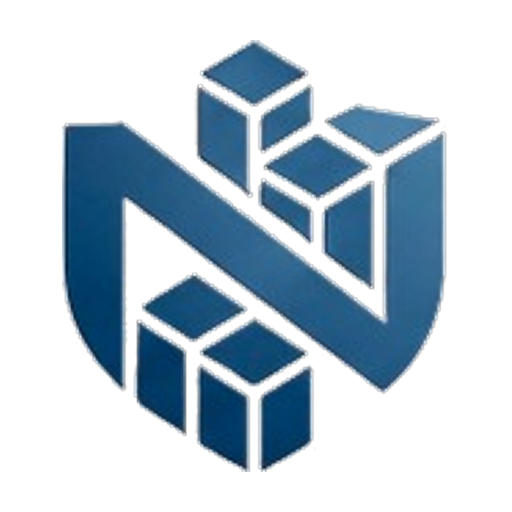
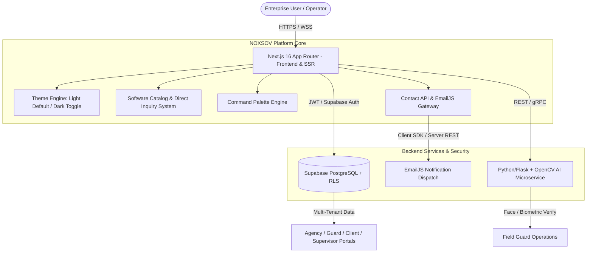

# NOXSOV — Sovereign Enterprise Software Ecosystem

<div align="center">



### *Autonomous Security. Automated Corporate Finance. High-Concurrency IT Infrastructure.*

[](https://nextjs.org/)
[](https://react.dev/)
[](https://www.typescriptlang.org/)
[](https://tailwindcss.com/)
[](https://supabase.com/)
[](https://opencv.org/)
[](https://www.emailjs.com/)

[**Explore Live Platform**](http://localhost:3000) • [**Software Catalog**](http://localhost:3000/store) • [**Products Overview**](http://localhost:3000/products) • [**Contact & Deployment**](http://localhost:3000/contact)

</div>

---

## 🏛️ Executive Summary & Architectural Philosophy

**NOXSOV** engineers mission-critical enterprise systems designed from first principles for sovereignty, high concurrency, and zero per-seat SaaS taxes.

Modern enterprise software traps organizations in perpetual per-user licensing penalties, vendor lock-in, and unpredictable cloud egress fees. NOXSOV breaks this paradigm:
- **Zero Per-Seat SaaS Taxes:** Deploy software across 10 or 10,000 operators with deterministic, single-fleet commercial terms.
- **Air-Gapped & Sovereign Ready:** Deployable on enterprise VPCs, on-premise Kubernetes clusters, or sovereign cloud infrastructure without forced external cloud telemetry.
- **Direct Enterprise Engagement:** Fixed-scope deployment consultation and direct contact form intake (`/contact`) routing inquiries directly to engineering leads.
- **Adaptive Ergonomics:** Native light theme default with seamless dark theme switching, responsive micro-animations, and full keyboard-driven navigation (`⌘K` / `Ctrl+K`).

---

## 🚀 Flagship Product Portfolio

### 1. 🛡️ Kryptik — Multi-Tenant Guard Management & Edge AI Platform
*Formerly known as Rakshak Security; engineered specifically for physical security agencies, patrol fleets, and multi-facility client sites.*

- **Multi-Tenant Workspace Isolation:** Each physical security firm operates in an isolated tenant sandbox powered by **Supabase PostgreSQL with Row-Level Security (RLS)**.
- **Role-Based 4-Portal Architecture:**
  1. **Agency Admin Portal:** Fleet scheduling, live GPS guard dispatch, time-clock logs, client contract SLAs, and compliance billing.
  2. **Field Guard Mobile / PWA:** Touch-optimized QR checkpoint patrol runner, incident reporting, panic triggers, offline synchronization, and full bilingual (English & Hindi) operational interface.
  3. **Client Facility Portal:** Real-time visibility into post coverage, guard attendance, incident audit logs, and digital post handover sign-offs.
  4. **Patrol Supervisor Inspector Portal:** Spot-check auditing, biometric presence verification, uniform readiness rating, and mobile guard inspection logging.
- **AI Verification Microservice:** Dedicated Python/Flask microservice utilizing OpenCV computer vision for biometric guard face verification and uniform compliance detection.
- **Security Audit Hardening:** Audited and fortified against `user_metadata` privilege escalation and unauthenticated internal inference endpoints.

---

### 2. 🎟️ NOXSOV Events — Sovereign Ticketing & Access Engine
- High-concurrency ticketing engine designed for stadiums, global expos, and private enterprise summits.
- Dynamic cryptographic QR admission passes refreshing every 15 seconds to eliminate ticket scalping and barcode cloning.
- Zero per-ticket fee structure — runs entirely within your private infrastructure.

---

### 3. ⚖️ NOXSOV Tax Incubator (Fiscal Matrix)
- Real-time corporate tax computation and automated multi-jurisdiction compliance matrix.
- Direct e-invoicing integrations with auditable sovereign ledgers and immutable record logging.
- Sub-second statutory calculation pipelines capable of processing thousands of enterprise transactions per minute.

---

### 4. 📦 NOXSOV Enterprise Core & ERP
- High-throughput warehouse, procurement, and inventory telemetry without recurring per-seat user licenses.
- Deterministic state management and auditable material traceability.

---

## ⚡ Platform Architecture & Tech Stack



### Core Technologies:
| Layer | Technologies |
| :--- | :--- |
| **Frontend Framework** | **Next.js 16.3.6 (App Router)** with **React 19** & Server Components |
| **Language** | **TypeScript 5** with strict null safety |
| **Styling & Design** | **Tailwind CSS v4**, Glassmorphism tokens, CSS variable-driven light/dark theming |
| **Motion & UX** | **Framer Motion**, Lucide React iconography, dynamic micro-interactions |
| **Data & Auth** | **Supabase** (PostgreSQL, Row-Level Security, Realtime channels, Supabase Auth) |
| **AI / Computer Vision** | **Python 3.11**, **Flask**, **OpenCV** (Biometric & facial guard verification) |
| **Notification Services** | **EmailJS** (`@emailjs/browser` client dispatch + server REST fallback) |

---

## 💻 Interactive Platform Capabilities

1. **Software Solutions Catalog (`/store`):**
   - Live software catalog with tier capability breakdowns (Starter, Enterprise Agency, Sovereign Fleet).
   - "Request Deployment Quote" direct inquiry flow pre-filling chosen product and tier into the contact form.

2. **Global Command Palette (`⌘K` / `Ctrl+K`):**
   - Instant keyboard-driven search and navigation across products, architecture briefs, and contact avenues.

3. **Interactive Telemetry Simulator:**
   - Real-time simulated telemetry for edge cluster status, active nodes, throughput, latency, and packet drop monitoring.

4. **Contact Dispatch with EmailJS Integration (`/contact`):**
   - Live form submission wired to EmailJS with server-side REST fallback and unique tracking ticket ID generation (`TKT-2026-XXXX`).

---

## 📂 Project Directory Structure

```text
Noxsov/
├── public/                     # Static assets, branding, and icons
│   ├── NOXSOV LOGO.jpeg        # Master company emblem
│   ├── noxsov-logo.png         # Transparent 512x512 PNG emblem
│   ├── icon.png                # Favicon / PWA 512x512 icon
│   ├── apple-icon.png          # Apple touch 180x180 icon
│   ├── favicon.ico             # Multi-size Windows & browser ICO
│   └── images/                 # Product screenshots & media assets
├── src/
│   ├── app/                    # Next.js App Router routes & API endpoints
│   │   ├── layout.tsx          # Root layout with font, theme script, and modals
│   │   ├── page.tsx            # Flagship homepage
│   │   ├── about/              # Company narrative & sovereign manifesto
│   │   ├── products/           # Deep-dive product briefs (Kryptik, Events, Tax, etc.)
│   │   ├── categories/         # Security, Finance, and IT Solutions hubs
│   │   ├── store/              # Software catalog & direct quote request
│   │   ├── contact/            # Enterprise briefing & deployment request form
│   │   └── api/
│   │       └── contact/        # Server-side Contact & EmailJS REST endpoint
│   ├── components/             # Reusable UI component library
│   │   ├── layout/             # Navbar, Footer, MobileNav
│   │   ├── home/               # Hero, ValueProps, LiveTelemetry, ProductGrid
│   │   ├── store/              # StoreCatalogView, StoreProductCard
│   │   ├── contact/            # ContactForm (live EmailJS integration)
│   │   ├── theme/              # ThemeProvider & ThemeToggle
│   │   └── ui/                 # BrandLogo, BackToTop, CommandPalette, Badges
│   ├── context/                # React context providers
│   ├── data/                   # Structured catalog data, products, and specs
│   ├── lib/                    # Helper libraries & email.ts
│   └── types/                  # TypeScript domain models and interfaces
├── .env.example                # Example environment variable template
├── .env.local                  # Local environment configuration (git-ignored)
├── next.config.ts              # Next.js build configuration
├── tailwind.config.ts          # Tailwind styling tokens
└── tsconfig.json               # TypeScript compiler configuration
```

---

## 🛠️ Getting Started & Local Development

### Prerequisites
- **Node.js**: `v20.x` or higher
- **npm**: `v10.x` or higher (or `pnpm` / `yarn`)
- **Git**

### Installation

1. **Clone the repository:**
   ```bash
   git clone https://github.com/VinayakJain-codes/Noxsov-Main-Websites.git
   cd Noxsov-Main-Websites
   ```

2. **Install dependencies:**
   ```bash
   npm install
   ```

3. **Configure Environment Variables:**
   Copy the example environment template and configure your keys:
   ```bash
   cp .env.example .env.local
   ```
   Open `.env.local` and enter your EmailJS credentials (see [Environment Variables Reference](#-environment-variables-reference)).

4. **Start the development server:**
   ```bash
   npm run dev
   ```
   Open [http://localhost:3000](http://localhost:3000) in your browser. The platform will automatically load in **Light Theme by default**!

5. **Build for production:**
   ```bash
   npm run build
   ```

6. **Run production server:**
   ```bash
   npm run start
   ```

---

## 🔐 Environment Variables Reference

| Variable Name | Required | Default / Description |
| :--- | :---: | :--- |
| `NEXT_PUBLIC_EMAILJS_SERVICE_ID` | Optional | EmailJS Service ID (e.g. `service_xxxxxx`). Configured in EmailJS dashboard. |
| `NEXT_PUBLIC_EMAILJS_TEMPLATE_ID`| Optional | EmailJS Template ID (e.g. `template_xxxxxx`). Template variables: `{{from_name}}`, `{{from_email}}`, `{{company}}`, `{{message}}`, `{{ticket_id}}`. |
| `NEXT_PUBLIC_EMAILJS_PUBLIC_KEY`  | Optional | EmailJS Public API key for browser-side dispatch. |
| `NEXT_PUBLIC_CONTACT_TO_EMAIL`    | Optional | Recipient contact mailbox (Default: `sales@noxsov.com`). |

> *Note: If EmailJS credentials are omitted, the contact form gracefully simulates submissions locally with high-fidelity sovereign ticket receipts (`TKT-2026-XXXX`).*

---

## 🛡️ Security & Tenant Isolation Standards

- **Zero Privilege Escalation:** Role metadata is strictly bound to server-side Postgres tables with strict Foreign Key constraints and Supabase RLS, preventing `user_metadata` tampering.
- **Air-Gapped Telemetry:** No mandatory external beaconing or telemetry trackers.
- **Rate-Limited Endpoints:** Contact APIs enforce sub-second payload checks and input sanitation.

---

## 🎨 Design System & Theme Engine

NOXSOV features a custom **Adaptive Theme Architecture**:
- **Default Theme:** **Light Theme** for maximum readability, contrast, and clean enterprise presentation.
- **Theme Switching:** Instant toggle to high-contrast OLED Dark Theme (`#06090e`).
- **Anti-Flicker SSR Script:** Inline execution in `<head>` guarantees zero theme flash on initial page load.
- **Design Tokens:** Tailwind CSS v4 variables with high-contrast text, subtle glassmorphism cards, cyan/emerald state badges, and smooth micro-interactions.

---

## 📄 License & Intellectual Property

Copyright © 2026 **NOXSOV Pvt. Ltd. (Estb. 2026)**. All rights reserved.  
All software architectures, product specifications, and documentation are proprietary to NOXSOV. Perpetual enterprise licenses are granted subject to individual Master Services Agreements (MSA).

---

<div align="center">
  <sub>Engineered for digital sovereignty. Built with pride by the NOXSOV Core Engineering Team.</sub>
</div>
